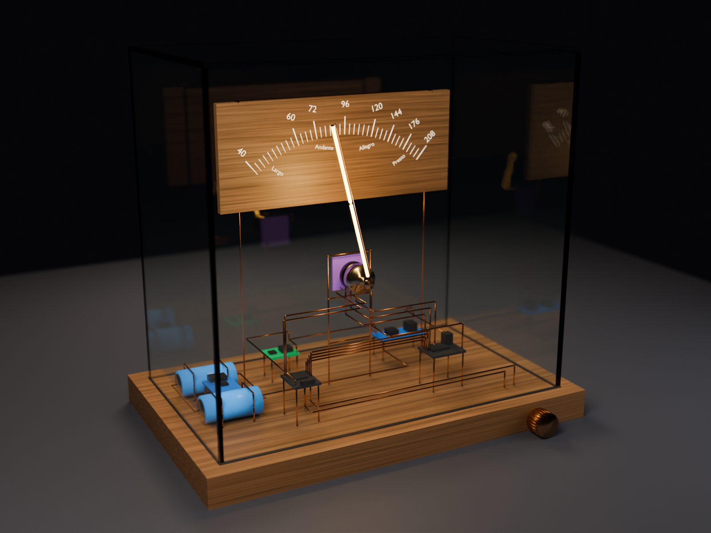
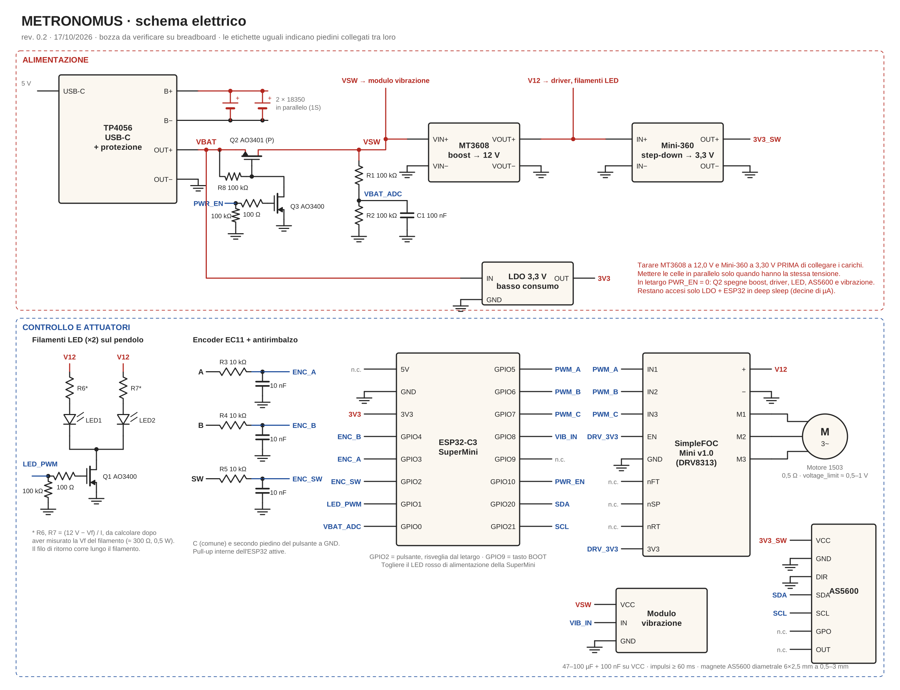
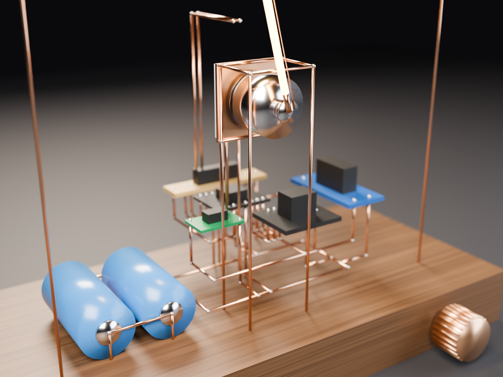

# Metronomus · Take Your Time

> Un metronomo artistico: un pendolo di luce mosso da un motore brushless, governato da un ESP32, con il circuito esposto in filo di rame da 1 mm, segmenti dritti saldati ad angolo retto.

**Stato:** 🟡 Fase 3 · disposizione del circuito in rame, in attesa delle misure reali dei moduli (vedi [stato](docs/STATO.md) e [roadmap](docs/roadmap.md))

---

## Indice
1. [Il concept](#il-concept)
2. [Come funziona](#come-funziona)
3. [Componenti](#componenti)
4. [Schema a blocchi](#schema-a-blocchi)
5. [Elettronica](#elettronica)
6. [Firmware](#firmware)
7. [Il circuito in rame](#il-circuito-in-rame)
8. [Produzione: PDF 1:1](#produzione-pdf-11)
9. [Uso](#uso)
10. [Struttura del repository](#struttura-del-repository)
11. [Come lavoriamo: i ruoli](#come-lavoriamo-i-ruoli)
12. [Roadmap e decisioni](#roadmap-e-decisioni)

---

## Il concept

Un metronomo che è anche una scultura. Al posto dell'asta con il peso c'è un **tubo LED da 5 cm** fissato all'albero di un **motore brushless**, che oscilla come un pendolo e si accende a ogni battito. Tutta l'elettronica è a vista: i collegamenti non stanno su un circuito stampato ma sono **segmenti dritti di rame da Ø 1 mm** saldati ad angolo retto con precisione millimetrica, che fanno anche da struttura.

Tutto sta su una base di legno, dentro una piccola teca di vetro: il pomello dell'encoder esce dal bordo anteriore della base e la presa USB‑C è sul retro.



_Render indicativo, generato con `python render/concept.py teca` (Blender come modulo Python)._

## Come funziona

- **Ruoti l'encoder** → cambia il tempo (BPM): il pendolo si ferma e fa da lancetta su una scala Maelzel incisa al laser sulla base. Quando lasci l'encoder riparte a battere il nuovo tempo. Niente display ([dettagli](docs/decisioni.md#indicatore-del-tempo-il-pendolo-come-lancetta)).
- **L'ESP32** calcola la traiettoria del pendolo e comanda il **driver** del motore.
- **Il sensore magnetico** legge la posizione dell'albero, così il pendolo sa dove si trova e quando invertire.
- **Il LED** si accende o pulsa sul battito.
- **La batteria** si ricarica dalla presa USB.

Il movimento ideale è sinusoidale, come un pendolo vero: `θ(t) = A · sin(π · BPM/60 · t)`. Ogni estremo dell'oscillazione è un battito.

## Componenti

Elenco completo e modelli in [hardware/bom.md](hardware/bom.md).

| Componente | Modello | Stato |
|---|---|---|
| ESP32 | ESP32‑C3 SuperMini | ✅ disponibile |
| Driver brushless | SimpleFOC Mini v1.0 (DRV8313, 8–30 V) | ✅ disponibile |
| Motore brushless | 1503, 7,4 V, 0,3 A, 0,5 Ω | ✅ disponibile |
| Batteria | 2 × 18350 in parallelo (1S, 3,7 V) | ✅ disponibile |
| Caricatore USB | TP4056 USB‑C con protezione | ✅ disponibile |
| Rotary encoder | EC11 con pulsante | ✅ disponibile |
| LED a tubo 5 cm | Filamento LED rigido (~3 V) | ✅ disponibile |
| Sensore magnetico | AS5600, encoder magnetico assoluto I2C | ✅ disponibile |
| Boost MT3608, step‑down Mini‑360 | — | ✅ disponibili |
| LDO 3,3 V, MOSFET (AO3401, AO3400), partitore, debounce | proposti | 🛒 da comprare |

## Schema a blocchi

```
 USB‑C ──► [TP4056] ──► [2×18350 in parallelo] ─┬─► [LDO 3,3 V] ──► ESP32 (sempre acceso)
                                               └─► [MOSFET] ──► [MT3608 12 V] ─┬─► [SimpleFOC Mini] ──► Motore
                                                     ▲                         ├─► Filamenti LED
                                               PWR_EN (ESP32)                  └─► [Mini‑360 3,3 V] ──► AS5600
                                                                                               │
 [Rotary encoder] ──► ESP32 ◄── [Sensore magnetico] ◄── magnete sull'albero ◄───────────────────┤
                       │                                                                       │
                       └──► [MOSFET] ──► LED a tubo (sull'albero) ◄────────────────────────────┘
```

## Elettronica

**Driver:** SimpleFOC Mini v1.0, basato su DRV8313. Il motore va alimentato a 8–30 V (consigliati 10–12 V), la logica è a 3,3 V e si collega direttamente all'ESP32 con 3 PWM (IN1–IN3) più EN.

**Alimentazione:** due 18350 in parallelo (1S, 3,0–4,2 V), ricaricate da USB‑C con il TP4056 che include la protezione. Un boost MT3608 porta tutto a 12 V per il driver (che vuole almeno 8 V); dai 12 V uno step‑down Mini‑360 ricava 3,3 V per il pin 3V3 dell'ESP32. Tarare entrambi i trimmer prima di collegare i carichi. Le due celle vanno messe in parallelo solo quando hanno la stessa tensione.

**Motore:** 1503 a bassa resistenza (0,5 Ω). Il driver lavora a 12 V ma il firmware limita la tensione di fase a circa 0,5–1 V, così la corrente resta entro 1–2 A e il motore non scalda.

**Sensore:** AS5600 (I2C, 12 bit) dietro al motore, con il magnete diametrale incollato sull'estremità dell'albero che sporge dalla base del 1503; pin DIR a GND. Il LED si monta sulla campana, davanti.

**Encoder:** EC11 nudo con pulsante, pull‑up interne dell'ESP32 e debounce RC. È anche l'unico comando: **3 secondi di pressione mettono il metronomo in letargo**, altri 3 lo risvegliano. Niente interruttore: in letargo un MOSFET spegne tutta la parte di potenza e resta acceso solo l'ESP32 in deep sleep (decine di µA).

**Teca:** il metronomo sta su una base di legno dentro una piccola teca di vetro; il pomello dell'encoder sporge dal bordo della base, la USB‑C è sul retro.

**Microcontrollore:** ESP32‑C3 SuperMini. Usa 12 dei suoi 13 GPIO: tre PWM e l'abilitazione per il driver, I2C per l'AS5600, tre ingressi per l'encoder, un'uscita per i LED, una per il motorino a vibrazione e un ingresso analogico per la batteria.

**Tic:** un motorino a vibrazione fissato sotto la base di legno dà un colpetto a ogni battito (impulsi da almeno 60 ms).

**Luce:** due filamenti LED in parallelo sul pendolo, comandati da un solo MOSFET. Pinout completo in [hardware/pinout.md](hardware/pinout.md).

_Il resto è in definizione._ Analisi di partenza, punti critici e parti mancanti: [docs/analisi-iniziale.md](docs/analisi-iniziale.md).
Schema elettrico completo in [hardware/schema.md](hardware/schema.md) (PDF A3 in [hardware/schema.pdf](hardware/schema.pdf)).



## Firmware

_Da scrivere._ Base prevista: Arduino/PlatformIO + libreria [SimpleFOC](https://simplefoc.com) per il controllo del brushless.
Funzioni previste: BPM 40–208 sulla scala Maelzel (39 posizioni), modalità impostazione con il pendolo come lancetta, start/stop e tap tempo dal pulsante dell'encoder, LED sincronizzato, accento, misura batteria, auto‑spegnimento.

## Il circuito in rame

- Filo di rame Ø 1,0 mm, raddrizzato in trazione. **Nessuna piega**: solo segmenti dritti tagliati a misura e saldati ad angolo retto (giunti a L e a T).
- Ogni segmento appartiene a una rete elettrica (GND, VBAT, 3V3, segnali…) e ha un codice.
- In ogni giunto un segmento è passante e l'altro è in battuta sul suo fianco: le lunghezze di taglio ne tengono conto e sono corrette con giunti di prova ([fili/prove-giunti.md](fili/prove-giunti.md)).
- Le teste dei segmenti in battuta si limano in squadra con una battuta di fine corsa.
- **Nessun pezzo più corto di 10 mm**, e assi di reti diverse ad almeno 2,5 mm. Reti diverse corrono su piani separati: masse su un anello a 6 mm dalla base, 12 V su una dorsale a 14 mm, ponti a U a 18 mm sotto le schede.
- La geometria parte dai **fori reali dei moduli** ([fili/moduli.yaml](fili/moduli.yaml), da misurare col calibro: [fili/misure-da-prendere.md](fili/misure-da-prendere.md)). `python fili/geometria.py` dispone i moduli, traccia i fili, controlla le regole e scrive la distinta [fili/segmenti.csv](fili/segmenti.csv) e il modello [modello/metronomus.scad](modello/metronomus.scad).


- Una dima incisa al laser tiene i fili in posizione durante la saldatura.

### Attrezzi
Calibro, tronchesino a taglio piano, lima fine e battuta di fine corsa per tagli in squadra, saldatore a punta fine e stagno, morsa per raddrizzare il filo, dima con squadre.

## Produzione: PDF 1:1

Quando il progetto sarà definito, in `produzione/` ci sarà un PDF da stampare **al 100%** (controllare il righello di 100 mm in prima pagina) con, per ogni filo: codice, rete, lunghezza di taglio, disegno in scala reale, tipo di ciascuna estremità (passante o in battuta), giunti a cui appartiene e ordine di saldatura.

## Uso

_Da scrivere quando il firmware è pronto._

## Struttura del repository

```
Metronomus/
├── README.md              questa pagina
├── CHANGELOG.md           storico delle modifiche
├── CLAUDE.md              istruzioni per Claude in questo progetto
├── .claude/               comandi /stato e /fine-sessione, ruoli dei subagenti per Claude Code
├── agenti/                i 4 ruoli (coordinatore, git-readme, elettronica, piano-fili)
├── docs/                  stato attuale (STATO.md), decisioni, roadmap, domande aperte
├── hardware/              BOM, pinout, schema elettrico (schema.py lo rigenera)
├── firmware/              codice ESP32
├── modello/              modello 3D di controllo in OpenSCAD, generato da fili/geometria.py
├── render/               render di concept (concept.py, Blender come modulo Python)
├── fili/                  misure dei moduli, geometria del rame (geometria.py), distinta segmenti.csv
├── foto/                  foto dei componenti (driver, motore, AS5600, encoder, TP4056, MT3608, Mini‑360)
└── produzione/            PDF 1:1 di taglio e saldatura
```

## Come lavoriamo: i ruoli

Il progetto è organizzato in quattro ruoli, definiti in `agenti/`. Per usarli come subagenti di Claude Code basta copiare quei file in `.claude/agents/`.

| Ruolo | Si occupa di |
|---|---|
| **coordinatore** | Priorità, decisioni, roadmap, smistamento del lavoro |
| **git-readme** | README sempre completo, CHANGELOG, commit |
| **elettronica** | Componenti, schema, pinout, alimentazione, firmware |
| **piano-fili** | Geometria dei segmenti, distinta di taglio, giunti, dima, PDF 1:1 |

## Roadmap e decisioni

- [Roadmap](docs/roadmap.md)
- [Registro delle decisioni](docs/decisioni.md)
- [Domande aperte](docs/domande-aperte.md)
